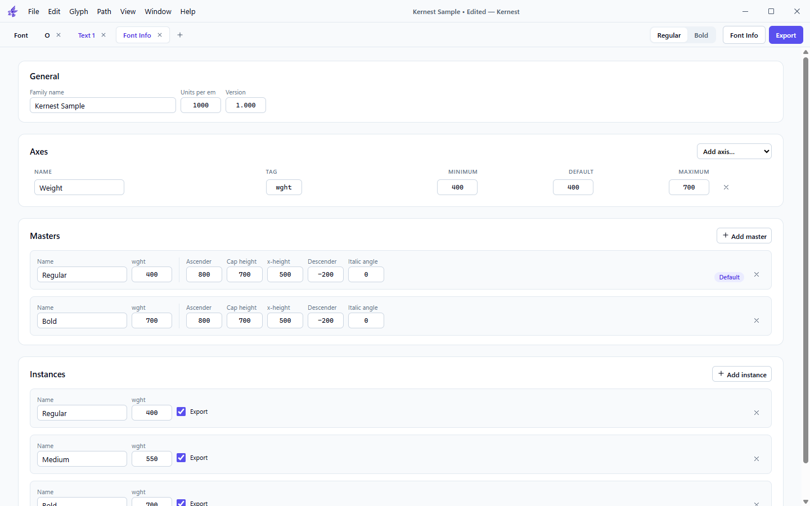

<p align="center">
  
</p>

<h1 align="center">Kernest</h1>

<p align="center">
  An open-source font editor for Windows. Draw glyphs, space and kern, interpolate masters and export TTF, OTF, WOFF2 and variable fonts (TrueType and CFF2) — offline, no account.
</p>

<p align="center">
  <a href="https://github.com/ShaikMoosa/kernest/releases">Download</a> ·
  <a href="docs/HANDBOOK.md">Handbook</a> ·
  <a href="#roadmap">Roadmap</a>
</p>


> **Status: 1.0.** You can create a font from glyph sets, browse, add and remove glyphs in Font View, draw and edit glyphs in Edit View (pen, rectangle, ellipse, point editing, components, copy/paste, sidebearings and metrics keys, path clean-up, intermediate and alternate layers, smart components, undo/redo), space and kern in text tabs and the kerning window (with kerning groups and exceptions), set up axes, masters and instances in Font Info with live interpolation previews and compatibility checks, export variable and static fonts as TTF, OTF and WOFF2 (with overlap removal), import Glyphs (`.glyphs`, `.glyphspackage`), UFO and designspace sources, and save/open `.kernest` fonts.

See the [Handbook](docs/HANDBOOK.md) for how to use Kernest.

## Screenshots

| | |
|---|---|
|  |  |
| **Edit View:** draw and edit outlines, components, sidebearings and metrics keys, intermediate and alternate layers. | **Text tabs:** set sample text to space and kern, with kerning groups and exceptions. |
|  |  |
| **Font Info:** axes, masters and instances, with live interpolation previews. | **Export:** variable and static fonts as TTF, OTF (CFF/CFF2) and WOFF2. |

## Install

Download the Windows setup program from the [Releases page](https://github.com/ShaikMoosa/kernest/releases): `Kernest_<version>_x64-setup.exe` for most PCs, or `Kernest_<version>_arm64-setup.exe` for Windows on ARM. Run it and choose **Install for me only** (no admin rights needed) or **all users**. Kernest is not distributed through the Microsoft Store or winget.

Requirements: Windows 10 22H2 or later, x64 or ARM64. The installer downloads Microsoft Edge WebView2 if it is missing (it is built into Windows 11).

## Build from source

Prerequisites: [Rust](https://rustup.rs) via rustup (MSVC toolchain; the version pinned in `rust-toolchain.toml` is installed automatically), [Node.js](https://nodejs.org) 24 or later, and Visual Studio Build Tools with the "Desktop development with C++" workload.

```bash
npm install
npm run tauri dev        # run the app with hot reload
cargo test --workspace   # run the Rust tests
npm run tauri build      # build the setup installer into target/release/bundle/nsis/
```

`npm run dev` alone serves the UI in a browser with an in-memory mock backend, which is handy for UI work (file dialogs and saving need the desktop app).

## Project layout

| Path | What it is |
|---|---|
| `crates/kernest-core` | Font data model, outline geometry, interpolation (with brace and bracket layers), path tools, overlap removal, metrics keys, glyph data and the `.kernest` file format. No UI dependencies. |
| `crates/kernest-export` | Export: writes UFOs and a designspace with norad, compiles TrueType and variable fonts with fontc, autohints them with tilvisan, and writes CFF (OTF) and WOFF2 itself. |
| `crates/kernest-import` | Import: converts Glyphs sources (with glyphs-reader) and UFO/designspace sources (with norad) into the Kernest model. |
| `src-tauri` | The desktop app shell (Tauri 2): window, file dialogs and the commands the UI calls. |
| `src` | The UI (React + TypeScript). `src/styles/tokens.css` holds the design tokens. |

## The `.kernest` format

A font is a folder, with one JSON file per glyph so changes diff and merge cleanly in Git:

```text
MyFont.kernest/
  font.json      format version, family info, axes, masters, glyph order
  kerning.json   kerning per master
  features.fea   OpenType feature code
  glyphs/
    A_.json      uppercase letters get a "_" so names stay unique on Windows
    a.json
```

Outline nodes are written as short strings such as `"80 0 line"` or `"300 700 curve smooth"`.

## Design

Wireframes, the design system (built on SegmentUI Kit 3.0) and hi-fi screens live in the Kernest Figma file. Design tokens in `src/styles/tokens.css` mirror the Figma variables `Kernest / Color` and `Kernest / Size`.

## Roadmap

### v1: the core editor (done)

| # | Milestone | Status |
|---|---|---|
| 1 | Font View and `.kernest` files | ✅ v0.1 |
| 2 | Edit View: pen tool, nodes, components | ✅ v0.2 |
| 3 | Spacing and kerning (text mode, kerning window, groups) | ✅ v0.3 |
| 4 | Masters, axes and interpolation | ✅ v0.4 |
| 5 | Export TTF and variable fonts (via [fontc](https://github.com/googlefonts/fontc)) | ✅ v0.5 |
| 6 | Import `.glyphs`, `.glyphspackage`, UFO and designspace | ✅ v0.6 |

### 1.0: ready for real fonts (done)

| Milestone | Status |
|---|---|
| Add and remove glyphs, logo, Handbook, About | ✅ v0.7 |
| Path tools: Correct Path Direction (with contour order), Add Extremes (cubic and quadratic), applied to every master so glyphs stay compatible | ✅ v0.8 |
| Brace (intermediate) and bracket (alternate) layers: editing, interpolation, export, Glyphs/designspace import | ✅ v0.8 |
| Export OTF (CFF outlines) and WOFF2 web fonts | ✅ v0.8 |
| Remove overlaps on export and as Path › Remove Overlap | ✅ v0.8 |
| Metrics keys (`=n`, `=\|H`, `=o+10`): editing, Glyph › Update Metrics, applied on export | ✅ v0.8 |
| Open fonts from Windows: Explorer "Open in Kernest", Open with, drag and drop, one window at a time | ✅ v0.9 |
| Variable OTF (CFF2) export and smaller OTF files (compact charstrings, subroutines) | ✅ v0.9 |
| Metrics keys imported from Glyphs files; alternate ranges include their maximum; full check of every feature | ✅ v1.0 |

Kernest 1.0 is complete: every milestone above has shipped.

### After 1.0

| Milestone | Status |
|---|---|
| Smart components: smart axes, pole layers, per-component values, Glyphs import | ✅ v1.1 |
| Autohinting for TrueType fonts, static and variable (ttfautohint, via tilvisan) | ✅ v1.2 |
| Colour fonts (COLRv1 and CPAL): palettes, colour layers, solid and gradient paints | ✅ v1.4 |
| Dark theme, ARM64 builds, Spanish and Arabic (right-to-left) interface | ✅ v1.3 |
| Anchors and component alignment: marks, ligature carets, cursive, composites from recipes | ✅ v1.5 |
| Features editor and Font Info fields: generated features, error checking, names, instance classes and style linking, notes | ✅ v1.6 |
| Guides, background layer, transform panel (scale, rotate, mirror, skew), measure tool, snap to grid | ✅ v1.7 |
| Path tools and filters: knife, open corners, reconnect and tidy up paths, Round Corners / Offset Curve / Transformations, lock and focus | ✅ v1.8 |
| Python scripting and plug-ins: out-of-process runner, Script menu and macro panel, filter and reporter plug-ins, Settings window | ✅ v2.0 |

### Next: one release per phase

The rest of the plan, in order. Each phase is built, tested, checked in the app, translated into Spanish and Arabic, then released.

| Phase | Release | What it adds | Status |
|---|---|---|---|
| 1 | 1.4 | Ship colour fonts | ✅ v1.4 |
| 2 | 1.5 | Anchors in the editor (marks, ligature carets, cursive), components that align to anchors, composites from recipes | ✅ v1.5 |
| 3 | 1.6 | Features editor with error checking and generated features; designer, vendor, copyright, weight/width class and style linking in Font Info; notes | ✅ v1.6 |
| 4 | 1.7 | Guides, background layer, transform panel (scale, rotate, mirror, skew), measure tool, snap to grid | ✅ v1.7 |
| 5 | 1.8 | Knife, open corners, reconnect and tidy up paths, lock and focus; Filter menu (Round Corners, Offset Curve, Transformations) | ✅ v1.8 |
| 6 | 2.0 | Python scripting (Script menu, macro panel) and plug-ins (filters, reporters), Settings window | ✅ v2.0 |
| 7 | 2.1 | Export UFO, Save As `.glyphs`, open compiled fonts, import SVG outlines, AFM and `.fea` | ✅ v2.1 |
| 8 | 2.2 | Font View list view with sortable, editable columns; cell size slider; languages sidebar with missing glyphs and Add Missing; smart filters and saved lists; tags and groups; production names; batch rename and batch commands; copy glyph names and Paste Special; drag or text glyph order | ✅ v2.2 |
| 9 | 2.3 | Axis mappings (avar) and STAT, several variable fonts per family, add masters from other fonts, compare fonts | ⏳ planned |
| 10 | 2.4 | Alignment zones and stems, PostScript hints, TrueType zones, pixel preview, manual TrueType instructions | ⏳ planned |
| 11 | 2.5 | Welcome screen, new font wizard, guided tour, font quality check, command line | ⏳ planned |

Later, not scheduled yet: strokes, brushes, corner and cap components, sbix and SVG colour, test install, kerning compress.

## Licence

Apache License 2.0 — see [LICENSE](LICENSE).
