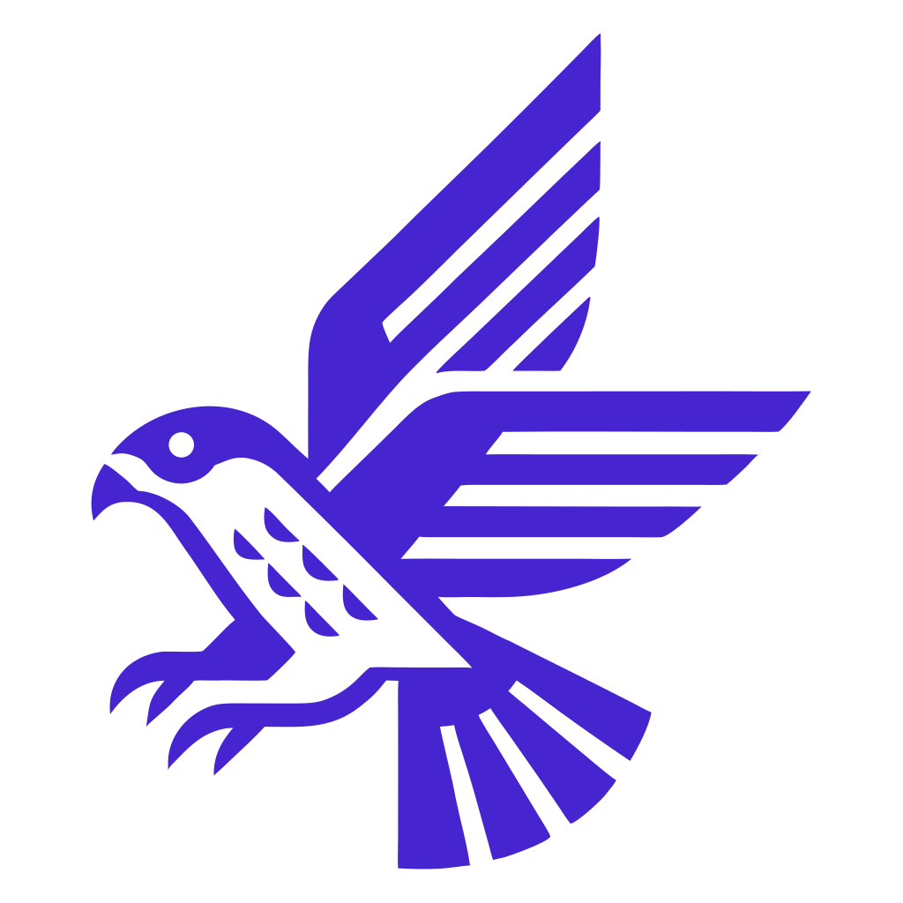
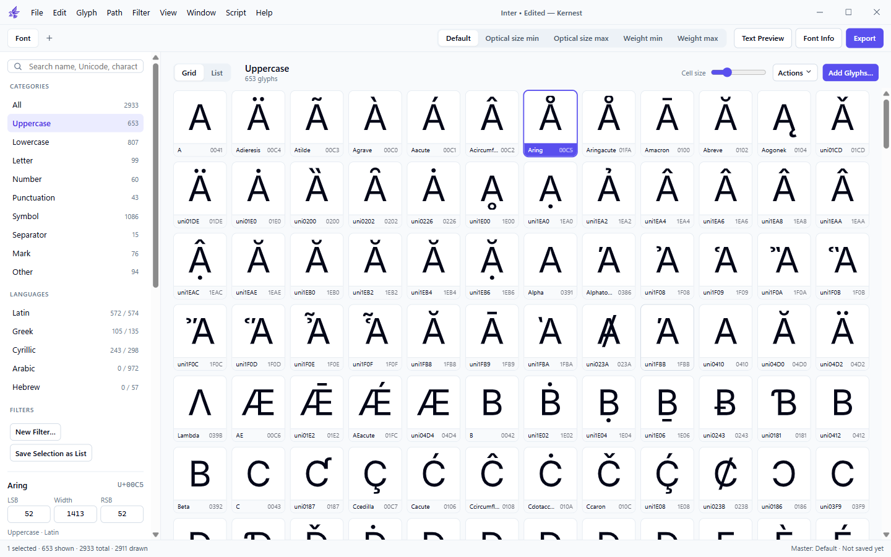
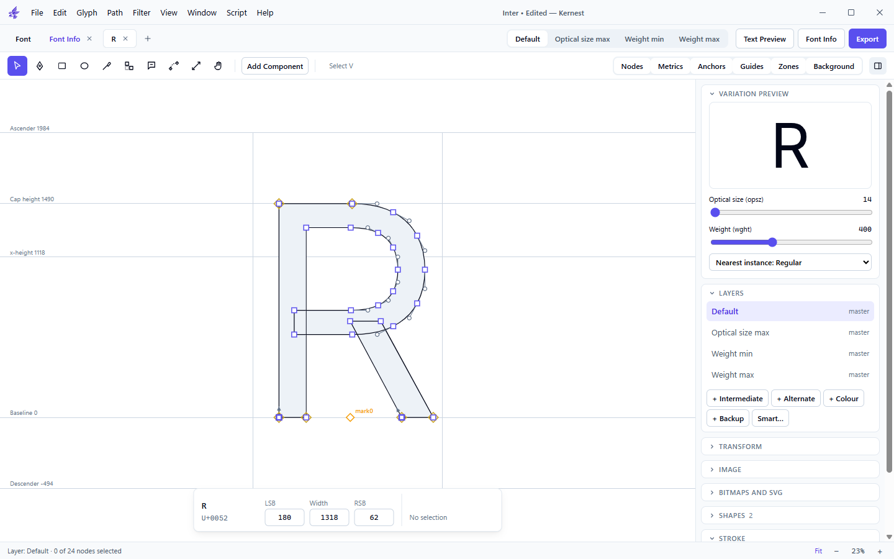
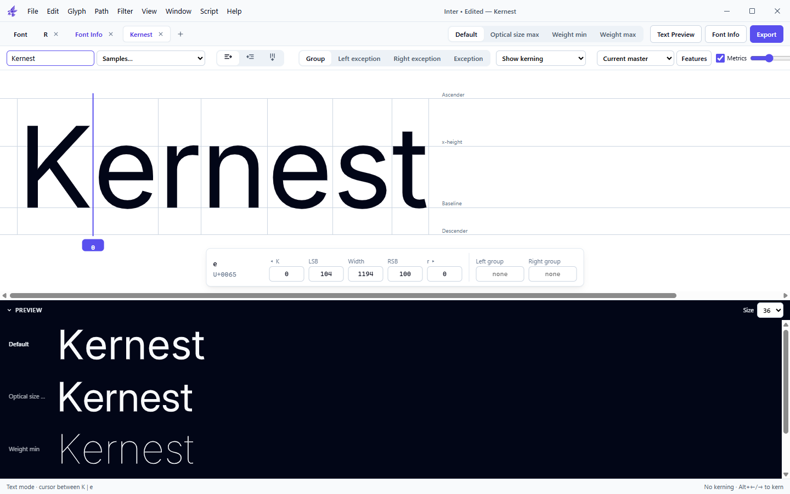
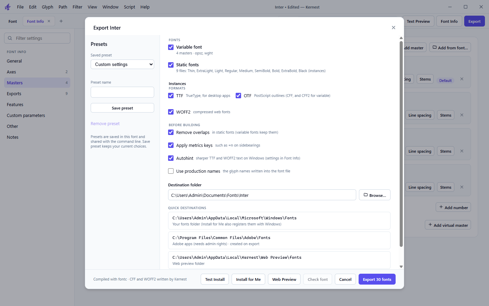

<p align="center">
  
</p>

<h1 align="center">Kernest</h1>

<p align="center">
  <b>An open-source font editor for Windows.</b><br>
  Draw glyphs, space and kern, interpolate masters and export TTF, OTF, WOFF2 and variable fonts. Offline, no account.
</p>

<p align="center">
  <a href="https://github.com/ShaikMoosa/kernest/releases/latest"></a>
  
  <a href="LICENSE"></a>
</p>

<p align="center">
  <a href="https://github.com/ShaikMoosa/kernest/releases/latest"><b>Download</b></a> ·
  <a href="docs/HANDBOOK.md">Handbook</a> ·
  <a href="docs/PYTHON_API.md">Python API</a> ·
  <a href="#roadmap">Roadmap</a>
</p>

<p align="center">
  
</p>

## Features

- **Draw:** pen, rectangle, ellipse, knife, lasso and point editing; components, smart components and corner/cap components; anchors and composites from recipes; guides, background layer, transform panel and measure tool; path filters such as Round Corners, Offset Curve and Remove Overlap.
- **Space and kern:** text tabs, the kerning window, kerning groups and exceptions, metrics keys, right-to-left and vertical text.
- **Design families:** axes, masters and instances with live interpolation previews, brace and bracket layers, avar and STAT, compatibility checks and one-click fixes for interpolation problems.
- **Export:** static and variable fonts as TTF, OTF (CFF and CFF2) and WOFF2, colour fonts (COLRv1, sbix, SVG), TrueType autohinting and PostScript hints, generated OpenType features with a features editor.
- **Open your sources:** import Glyphs (`.glyphs`, `.glyphspackage`), UFO, designspace and compiled fonts; export UFO and save as `.glyphs`.
- **Automate:** Python scripting, filter and reporter plug-ins, and a command line.
- **Made for Windows:** dark theme, ARM64 builds, Explorer integration, and an interface in English, Spanish and Arabic.

See the [Handbook](docs/HANDBOOK.md) for how to use each feature.

## Screenshots

<table>
  <tr>
    <td width="50%"></td>
    <td width="50%"></td>
  </tr>
  <tr>
    <td><b>Edit View:</b> draw and edit outlines, with a live variation preview and every master's layer at hand.</td>
    <td><b>Text tabs:</b> set text to space and kern, with kerning groups and exceptions and a preview in every master.</td>
  </tr>
  <tr>
    <td></td>
    <td></td>
  </tr>
  <tr>
    <td><b>Font Info:</b> axes, masters and instances, with checks that keep masters compatible.</td>
    <td><b>Export:</b> variable and static fonts as TTF, OTF (CFF/CFF2) and WOFF2.</td>
  </tr>
</table>

<sub>Screenshots show <a href="https://github.com/rsms/inter">Inter</a> by Rasmus Andersson, imported from its variable font (SIL Open Font License).</sub>

## Install

Download the Windows setup program from the [Releases page](https://github.com/ShaikMoosa/kernest/releases): `Kernest_<version>_x64-setup.exe` for most PCs, or `Kernest_<version>_arm64-setup.exe` for Windows on ARM. Run it and choose **Install for me only** (no admin rights needed) or **all users**. Kernest is not distributed through the Microsoft Store or winget.

Requirements: Windows 10 22H2 or later, x64 or ARM64. The installer downloads Microsoft Edge WebView2 if it is missing (it is built into Windows 11).

## Build from source

Prerequisites: [Rust](https://rustup.rs) via rustup (MSVC toolchain; the version pinned in `rust-toolchain.toml` is installed automatically), [Node.js](https://nodejs.org) 24 or later, and Visual Studio Build Tools with the "Desktop development with C++" workload.

```bash
npm install
npm run tauri dev        # run the app with hot reload
cargo test --workspace   # run the Rust tests
npm run tauri build      # build the setup installer into target/release/bundle/nsis/
```

`npm run dev` alone serves the UI in a browser with an in-memory mock backend, which is handy for UI work (file dialogs and saving need the desktop app).

## Project layout

| Path | What it is |
|---|---|
| `crates/kernest-core` | Font data model, outline geometry, interpolation (with brace and bracket layers), path tools, overlap removal, metrics keys, glyph data and the `.kernest` file format. No UI dependencies. |
| `crates/kernest-export` | Export: writes UFOs and a designspace with norad, compiles TrueType and variable fonts with fontc, autohints them with tilvisan, and writes CFF (OTF) and WOFF2 itself. |
| `crates/kernest-import` | Import: converts Glyphs sources (with glyphs-reader) and UFO/designspace sources (with norad) into the Kernest model. |
| `src-tauri` | The desktop app shell (Tauri 2): window, file dialogs and the commands the UI calls. |
| `src` | The UI (React + TypeScript). `src/styles/tokens.css` holds the design tokens. |

## The `.kernest` format

A font is a folder, with one JSON file per glyph so changes diff and merge cleanly in Git:

```text
MyFont.kernest/
  font.json      format version, family info, axes, masters, glyph order
  kerning.json   kerning per master
  features.fea   OpenType feature code
  glyphs/
    A_.json      uppercase letters get a "_" so names stay unique on Windows
    a.json
```

Outline nodes are written as short strings such as `"80 0 line"` or `"300 700 curve smooth"`.

## Design

Wireframes, the design system (built on SegmentUI Kit 3.0) and hi-fi screens live in the Kernest Figma file. Design tokens in `src/styles/tokens.css` mirror the Figma variables `Kernest / Color` and `Kernest / Size`.

## Roadmap

Kernest is at **2.15**. The 1.0 core editor and every planned phase after it have shipped; work now follows smaller tickets, one release at a time. Still unscheduled: manual TrueType instructions.

<details>
<summary>Release history by milestone</summary>

#### v1: the core editor (done)

| # | Milestone | Status |
|---|---|---|
| 1 | Font View and `.kernest` files | ✅ v0.1 |
| 2 | Edit View: pen tool, nodes, components | ✅ v0.2 |
| 3 | Spacing and kerning (text mode, kerning window, groups) | ✅ v0.3 |
| 4 | Masters, axes and interpolation | ✅ v0.4 |
| 5 | Export TTF and variable fonts (via [fontc](https://github.com/googlefonts/fontc)) | ✅ v0.5 |
| 6 | Import `.glyphs`, `.glyphspackage`, UFO and designspace | ✅ v0.6 |

#### 1.0: ready for real fonts (done)

| Milestone | Status |
|---|---|
| Add and remove glyphs, logo, Handbook, About | ✅ v0.7 |
| Path tools: Correct Path Direction (with contour order), Add Extremes (cubic and quadratic), applied to every master so glyphs stay compatible | ✅ v0.8 |
| Brace (intermediate) and bracket (alternate) layers: editing, interpolation, export, Glyphs/designspace import | ✅ v0.8 |
| Export OTF (CFF outlines) and WOFF2 web fonts | ✅ v0.8 |
| Remove overlaps on export and as Path › Remove Overlap | ✅ v0.8 |
| Metrics keys (`=n`, `=\|H`, `=o+10`): editing, Glyph › Update Metrics, applied on export | ✅ v0.8 |
| Open fonts from Windows: Explorer "Open in Kernest", Open with, drag and drop, one window at a time | ✅ v0.9 |
| Variable OTF (CFF2) export and smaller OTF files (compact charstrings, subroutines) | ✅ v0.9 |
| Metrics keys imported from Glyphs files; alternate ranges include their maximum; full check of every feature | ✅ v1.0 |

Kernest 1.0 is complete: every milestone above has shipped.

#### After 1.0

| Milestone | Status |
|---|---|
| Smart components: smart axes, pole layers, per-component values, Glyphs import | ✅ v1.1 |
| Autohinting for TrueType fonts, static and variable (ttfautohint, via tilvisan) | ✅ v1.2 |
| Colour fonts (COLRv1 and CPAL): palettes, colour layers, solid and gradient paints | ✅ v1.4 |
| Dark theme, ARM64 builds, Spanish and Arabic (right-to-left) interface | ✅ v1.3 |
| Anchors and component alignment: marks, ligature carets, cursive, composites from recipes | ✅ v1.5 |
| Features editor and Font Info fields: generated features, error checking, names, instance classes and style linking, notes | ✅ v1.6 |
| Guides, background layer, transform panel (scale, rotate, mirror, skew), measure tool, snap to grid | ✅ v1.7 |
| Path tools and filters: knife, open corners, reconnect and tidy up paths, Round Corners / Offset Curve / Transformations, lock and focus | ✅ v1.8 |
| Python scripting and plug-ins: out-of-process runner, Script menu and macro panel, filter and reporter plug-ins, Settings window | ✅ v2.0 |

#### Next: one release per phase

The rest of the plan, in order. Each phase is built, tested, checked in the app, translated into Spanish and Arabic, then released.

| Phase | Release | What it adds | Status |
|---|---|---|---|
| 1 | 1.4 | Ship colour fonts | ✅ v1.4 |
| 2 | 1.5 | Anchors in the editor (marks, ligature carets, cursive), components that align to anchors, composites from recipes | ✅ v1.5 |
| 3 | 1.6 | Features editor with error checking and generated features; designer, vendor, copyright, weight/width class and style linking in Font Info; notes | ✅ v1.6 |
| 4 | 1.7 | Guides, background layer, transform panel (scale, rotate, mirror, skew), measure tool, snap to grid | ✅ v1.7 |
| 5 | 1.8 | Knife, open corners, reconnect and tidy up paths, lock and focus; Filter menu (Round Corners, Offset Curve, Transformations) | ✅ v1.8 |
| 6 | 2.0 | Python scripting (Script menu, macro panel) and plug-ins (filters, reporters), Settings window | ✅ v2.0 |
| 7 | 2.1 | Export UFO, Save As `.glyphs`, open compiled fonts, import SVG outlines, AFM and `.fea` | ✅ v2.1 |
| 8 | 2.2 | Font View list view with sortable, editable columns; cell size slider; languages sidebar with missing glyphs and Add Missing; smart filters and saved lists; tags and groups; production names; batch rename and batch commands; copy glyph names and Paste Special; drag or text glyph order | ✅ v2.2 |
| 9 | 2.3 | Axis mappings (avar) and STAT axis values, several variable fonts per family, add masters from other fonts with a compatibility report, compare fonts, Generate Instances as a new font, colour that varies between masters (variable COLRv1) | ✅ v2.3 |
| 10 | 2.4 | Alignment zones and stems per master, PostScript hints in OTF exports (blue controls, automatic and manual glyph hints), TrueType control instructions, hinted vs unhinted pixel preview | ✅ v2.4 |
| 11 | 2.5 | Welcome screen, new font wizard, guided tour, font quality check, command line | ✅ v2.5 |

#### After the roadmap

| Release | What it adds | Status |
|---|---|---|
| 2.6 | Interpolation warnings: paths that run the other way, start points, contour order and kinks between masters, with a one-click fix | ✅ v2.6 |
| 2.7 | Ready for real fonts: tested on real families, fast Font View for large fonts, editable Unicode values, guides/backgrounds/locks and line spacing imported from Glyphs and UFO, colour written to `.glyphs`; line spacing editable in Font Info (2.7.1) | ✅ v2.7.1 |
| 2.8 | Nothing left behind: Glyphs variable font settings, right-to-left kerning, extra layers kept as backups, guides and backgrounds in UFO export, a Custom Parameters table; strokes and pen points (S28), brushes and the pixel tool (S59); corner, cap and segment components (S58); smart-glyph handles on the canvas (S57) | ✅ v2.8 |
| 2.9 | Masking and shape order (S29), images in the editor (S33), annotations (S32); higher-order interpolation tool (S40), virtual masters and glyph swaps (S39) | ✅ v2.9 |
| 2.10 | sbix bitmaps and SVG colour layers (S63); feature-code tokens and conditions (S64) | ✅ v2.12 |
| 2.11 | Test install, quick export destinations and web preview (S65); Explorer icon, tooltip and right-click actions, and update notice with Download & install (S70) | ✅ v2.12 |
| 2.12 | Kerning compress and clean-up (S56); remaining menu items (S46, S47) | ✅ v2.12 |
| 2.13 | Screens matched to the hi-fi designs: start window, wizard, font, edit, text and kerning views | ✅ v2.13 |
| 2.14 | Export fixes, Arabic and Syriac positional features, Disable Masters, feature-code tokens that compile | ✅ v2.14 |
| 2.15 | Path tools (lasso, G2 nodes and Harmonize, align and distribute, Union/Subtract/Intersect, magnetic snapping), right-to-left and vertical text, vertical metrics | ✅ v2.15 |

Screen numbers refer to the [Figma design board](https://www.figma.com/design/bTAtzDRACL76IlFIgHefpF/Kernest?node-id=58-6432).

</details>

## Licence

Apache License 2.0. See [LICENSE](LICENSE).
